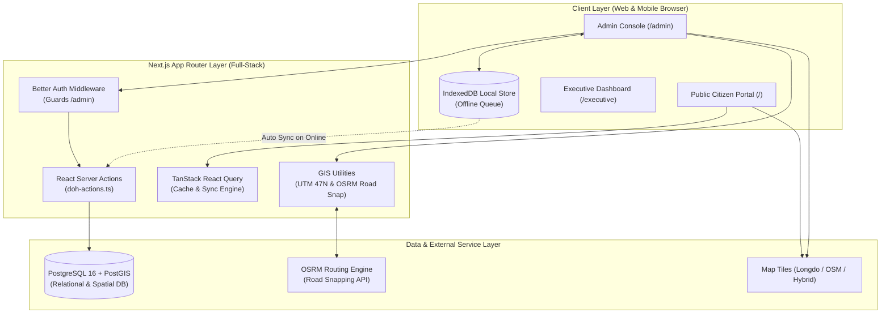

# สถาปัตยกรรมและการออกแบบระบบ DOH_Pattani_Flood (DESIGN.md)

> ⚠️ **ประกาศ (2026-11-08):** เอกสารนี้เป็นภาพรวมเชิงแนวคิดและบางส่วนเก่า (เช่น Server Actions, Docker Postgres, ซิงก์ผ่าน Server Actions) ระบบจริงเป็นเว็บ static บน GitHub Pages เรียก Edge Function `hdms-api` — ดูสถานะปัจจุบันที่ `docs/ARCHITECTURE.md` และกติกาการทำงานที่ `AGENTS.md`
**ระบบแผนที่รายงานสถานการณ์น้ำท่วมและเส้นทางเลี่ยง แขวงทางหลวงปัตตานี กรมทางหลวง**
**เวอร์ชัน:** 2.0.0 (Production Next.js + PostgreSQL/PostGIS)

---

## 1. บทนำและบริบทของระบบ (Executive Overview)
ระบบ DOH_Pattani_Flood ได้รับการพัฒนาขึ้นเพื่อยกระดับจากการทดสอบต้นแบบ (Google Apps Script + Google Sheets + Longdo Map) สู่สถาปัตยกรรมเว็บแอปพลิเคชันระดับองค์กร (Next.js App Router + PostgreSQL PostGIS + TanStack Query + Better Auth + IndexedDB) เพื่อตอบสนองความต้องการ 3 กลุ่มผู้ใช้งานหลัก:
1. **ประชาชนและผู้ใช้ทาง (Citizen-facing Portal):** ตรวจสอบจุดน้ำท่วมวิกฤตบนแผนที่แบบ Real-time, ค้นหาสายทาง, ตรวจสอบเส้นทางเลี่ยง (Detour Yellow Line), ดูกราฟประวัติระดับน้ำย้อนหลัง และตรวจสอบรูปถ่ายสภาพจริงหน้างาน
2. **เจ้าหน้าที่หมวดทางหลวง/แอดมิน (Field Staff & Admin Console):** บันทึกรายงานระดับน้ำหน้างานแบบอัตโนมัติด้วยระบบ Auto-GPS (สกัดจาก EXIF รูปถ่าย) พร้อมแปลงค่าพิกัด UTM Zone 47N, วาดแนวเส้นทางน้ำท่วมและทางเลี่ยงด้วยระบบ Road-snapping เกาะโครงข่ายถนนจริง, และจัดการเลเยอร์ SHP/KML/GeoJSON
3. **ผู้บริหารและผู้ว่าราชการจังหวัด (Governor & Executive Briefing):** ติดตาม KPI สถานการณ์น้ำท่วมรวมทั้งจังหวัด, ตรวจสอบภาพเปรียบเทียบ ก่อน-หลัง (Before & After) ของโครงการที่แก้ไขแล้วเสร็จ (6 แห่ง), และตรวจสอบรายละเอียดงบประมาณโครงการเร่งด่วนที่รอรับการจัดสรร (4 แห่ง วงเงิน 145.00 ล้านบาท)

---

## 2. ผังโครงสร้างสถาปัตยกรรม (System Architecture)

---

## 3. แบบจำลองข้อมูลและฐานข้อมูล (Database Schema & PostGIS)

ระบบใช้ PostgreSQL พร้อมส่วนเสริม PostGIS สำหรับการจัดเก็บและประมวลผลข้อมูลเชิงพื้นที่ โดยจัดแบ่งออกเป็น 5 ตารางหลัก:

### 3.1 ตาราง `doh_flood_routes` (จุดและแนวเส้นทางน้ำท่วม / Red Line)
- `id`: รหัสอ้างอิง เช่น `'F-001'`
- `route_no`: หมายเลขทางหลวง เช่น `'43'`, `'418'`, `'410'`
- `section_name`: ชื่อตอนควบคุมและจุดเกิดเหตุ เช่น `'บ่อทอง - ดอนยาง (อ.หนองจิก)'`
- `km_start`, `km_end`: ช่วงหลักกิโลเมตร เช่น `'52+100'`, `'54+800'`
- `lat_start`, `lon_start`, `lat_end`, `lon_end`: พิกัดภูมิศาสตร์จุดเริ่มต้นและสิ้นสุด
- `coordinates_json`: JSONB เก็บชุดพิกัด `[[lon, lat], ...]` ของแนวเส้นทาง
- `water_level_cm`: ระดับน้ำท่วมขังบนผิวทาง (ซม.)
- `traffic_status`: สถานะการจราจร (`'CLOSED'`, `'WARNING'`, `'PASSABLE'`)
- `latest_photo_url`: URL ภาพถ่ายสภาพน้ำท่วมล่าสุด
- `is_active`: สถานะเปิด/ปิดการรายงานบนแผนที่

### 3.2 ตาราง `doh_detour_routes` (เส้นทางเลี่ยงน้ำท่วม / Yellow Line)
- `id`: รหัสเส้นทางเลี่ยง เช่น `'D-001'`
- `flood_id_ref`: อ้างอิงจุดน้ำท่วมใน `doh_flood_routes(id)`
- `route_name`: ชื่อเส้นทางเลี่ยง เช่น `'ทางเลี่ยง ทล.42 -> ทล.4092'`
- `coordinates_json`: แนวเส้นทางเลี่ยงแบบเส้นประสีเหลือง
- `description`: คำแนะนำสำหรับประชาชน เช่น แนะนำรถเล็กวิ่งเลี่ยงเข้า ทล.42

### 3.3 ตาราง `doh_timeline_updates` (ประวัติการรายงานระดับน้ำตามช่วงเวลา)
- `id`: รหัสรายการ เช่น `'TL-101'`
- `flood_id_ref`: อ้างอิงจุดน้ำท่วม
- `reported_at`: วันเวลาที่รายงาน (TIMESTAMPTZ)
- `water_level_cm`: ระดับน้ำ ณ เวลาที่บันทึก
- `traffic_status`: สถานะการจราจร
- `latitude`, `longitude`: พิกัดที่เจ้าหน้าที่กดบันทึกหรือสกัดจาก EXIF
- `photo_url`: รูปถ่ายหน้างาน
- `reporter_name`: ผู้รายงาน / หมวดทางหลวง
- `remark`: หมายเหตุและมาตรการแก้ไขเฉพาะหน้า

### 3.4 ตาราง `doh_mitigation_projects` (โครงการแก้ไขปัญหาน้ำท่วมสำหรับรายงานผู้ว่าฯ)
- `project_id`: รหัสโครงการ เช่น `'P-01'` ถึง `'P-10'`
- `route_no`: สายทาง ทล.
- `location_name`: ชื่อตอน / บริเวณ
- `km_range`: ช่วง กม.
- `status_group`: สถานะโครงการ (`'COMPLETED'` หรือ `'PENDING_BUDGET'`)
- `solution_detail`: รายละเอียดแนวทางการแก้ไขปัญหาเชิงวิศวกรรม (เช่น ก่อสร้าง Box Culvert, ยกระดับคันทาง)
- `budget_mb`: วงเงินงบประมาณ (ล้านบาท)
- `before_image_url`, `after_image_url`: รูปภาพเปรียบเทียบก่อนและหลังแก้ไข

### 3.5 ตาราง `doh_highway_layers` (เลเยอร์โครงข่ายทางหลวง GIS)
- `layer_id`: `'MAIN_HIGHWAY'`, `'SECOND_HIGHWAY'`
- `layer_name`: ชื่อโครงข่าย
- `color_hex`: สีเส้น (Hex)
- `line_width`: ขนาดความหนาของเส้น (px)
- `geojson_data`: โครงสร้าง FeatureCollection สำหรับเรนเดอร์โครงข่ายทางหลวงทั้งจังหวัด

---

## 4. กระบวนการประมวลผลเชิงพื้นที่และระบบพิกัด (GIS Engine)

### 4.1 การแปลงพิกัด WGS84 เป็น UTM Zone 47N (EPSG:32647)
เนื่องจากงานวิศวกรรมทางหลวงในประเทศไทย โดยเฉพาะเขตจังหวัดปัตตานี อยู่ในระบบพิกัดฉากกริด **UTM โซน 47 เหนือ (เส้นเมริเดียนกลาง 99° ตะวันออก)** ระบบจึงบรรจุอัลกอริทึมแปลงพิกัดภูมิศาสตร์ (Lat, Lon) เป็นค่า Easting (E) และ Northing (N) โดยตรงใน `lib/gis-utils.ts` อิงทรงรี WGS84 ($a = 6378137.0$ ม., $f = 1/298.257223563$, $k_0 = 0.9996$, False Easting = $500000.0$ ม.) ช่วยให้เจ้าหน้าที่หน้างานสามารถรายงานพิกัดให้ฝ่ายสำรวจได้ทันที

### 4.2 ระบบดึงเส้นเกาะถนนจริง (OSRM Road-Snapping Engine)
เมื่อแอดมินคลิกกำหนดจุดเริ่มต้น จุดสิ้นสุด หรือเพิ่มจุด Waypoints บนแผนที่ ระบบจะส่งคำขอไปยัง OSRM Driving Router เพื่อดึง Geometry ที่โค้งเว้าตามผิวถนนจริง ไม่ใช่เส้นตรงแบบรัศมี ช่วยให้ประชาชนเห็นแนวเส้นทางน้ำท่วมและทางเลี่ยงได้อย่างแม่นยำ 100%

---

## 5. ยุทธศาสตร์ความมั่นคงและการทำงานแบบออฟไลน์ (Offline-First Architecture)

- **IndexedDB Sync Queue:** ในพื้นที่อุทกภัยที่มีปัญหาสัญญาณอินเทอร์เน็ต เจ้าหน้าที่หมวดทางหลวงสามารถเปิดหน้าเว็บบันทึกระดับน้ำและแนบรูปถ่ายได้ตามปกติ ข้อมูลจะถูกจัดเก็บลง IndexedDB (`DOH_PATTANI_OFFLINE_STORE`) โดยอัตโนมัติ
- **Reactive Background Replay:** เมื่ออุปกรณ์สามารถเชื่อมต่อเครือข่ายอินเทอร์เน็ตได้ (`window.addEventListener('online')`) ระบบจะนำรายการที่ค้างส่งทยอยซิงค์ขึ้น Server Actions และอัปเดตลงฐานข้อมูล PostgreSQL โดยอัตโนมัติ
- **Resilient Fallback:** ในกรณีที่เริ่มรันระบบใหม่ก่อนเปิด Docker ฐานข้อมูล ระบบมี In-Memory Cache ที่เชื่อมข้อมูล DOH Pattani Seed ไว้ครบถ้วน จึงพร้อมใช้งานทันทีโดยไม่เกิด Runtime Crash

---

## 6. กรอบความมั่นคงปลอดภัยและการกำกับดูแล AI (AI Governance & Safety Guardrails)

ระบบได้กำหนดกรอบความปลอดภัยในการปฏิบัติงานร่วมกับ AI Assistant (Antigravity) ไว้อย่างชัดเจน (อ้างอิง [DECISION_LOG.md](DECISION_LOG.md)):
1. **การแบ่งแยกสภาพแวดล้อม (Environment Isolation):** Development/Staging มีสิทธิ์ทำงานได้เต็มรูปแบบตาม Requirement; ในขณะที่ Production ถูกจำกัดให้อ่านอย่างเดียว (Read-only) เป็นค่าเริ่มต้น
2. **การควบคุมการเปลี่ยนแปลง Production:** ทุกการ Deploy, Database Migration, Backfill, Delete ข้อมูล หรือการหมุนเวียน Secret ต้องประเมินผลกระทบ (Impact) จัดทำแผนย้อนกลับ (Rollback Plan) และบันทึกลงใน Decision Log ก่อนเสมอ
3. **การจัดการ Credential & สิทธิ์ขั้นต่ำ (Least Privilege):** ใช้งาน Secret Manager สำหรับทุกความลับของระบบ ไม่อนุญาตสิทธิ์ Root, Cloud Owner หรือสิทธิ์เขียน Database Production แบบถาวร
4. **บันทึกการเชื่อมต่อ (Integration Tracking):** ทุก Service Integration (รวมถึง Supabase, OSRM, Storage) มีการบันทึก Owner, Scope, สิทธิ์การเข้าถึง และขั้นตอนการ Revoke อย่างเป็นระบบ
